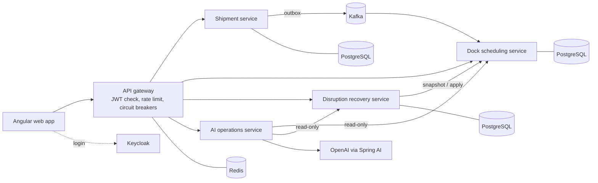

# DockMind AI

**Multi-tenant warehouse dock scheduling and disruption recovery platform**, built with Java 21,
Spring Boot 4, Kafka, PostgreSQL, Angular and Spring AI.

Warehouses book trucks into a limited number of loading docks. When a truck arrives late or a dock
breaks down, the day's schedule falls apart and dispatchers re-plan by hand. DockMind computes a
constraint-aware schedule for each day, generates and compares recovery plans when something goes
wrong, applies a plan only after a person approves it, and records every decision in an audit trail
that cannot be edited.


## Results

All numbers below are produced by code in this repository and can be reproduced with the commands
in [Running locally](#running-locally). Workloads are synthetic and seeded.

**Scheduling** (140 trucks/day, mean of 5 seeds, every schedule checked by an independent validator):

| | First-come-first-served | DockMind dispatcher |
|---|---|---|
| Trucks left unscheduled | 10.4 | **0.0** |
| Urgent trucks: average wait | 37.6 min | **6.7 min** |
| Dock utilization | 55.0% | **59.7%** |
| Average wait, all trucks | **54.7 min** | 75.9 min (serves the trucks FCFS drops) |

**Disruption recovery** (50 seeded late-arrival and dock-outage cases): every recommended plan was
valid with no urgent truck dropped. The minimal-change strategy moved on average 0.4 appointments
for a late truck and 3.0 for a two-hour dock outage, versus 22.1 and 50.7 for a full reschedule.

**API latency under load** (k6, 15 requests/s for 2 minutes through the gateway, full system running
locally in Docker): p50 8.8 ms, p95 23.7 ms, p99 31.7 ms, 0% failed requests.

Full tables: [docs/benchmarks/RESULTS.md](docs/benchmarks/RESULTS.md),
[docs/benchmarks/load/RESULTS.md](docs/benchmarks/load/RESULTS.md).

## Features

- **Scheduling engine.** Assigns trucks to docks respecting dock capabilities (refrigerated,
  hazmat, oversized), arrival windows, loading time, priority, opening hours and crew limits.
  Framework-free and deterministic, benchmarked against a first-come-first-served baseline.
- **Disruption recovery.** Late arrivals and dock outages produce two validated plans, minimal
  change and full reschedule, ranked by urgent trucks dropped, trucks dropped and appointments moved.
- **Human approval and audit.** Plans are applied only after approval; large changes require an
  admin. The audit table is append-only, enforced by database triggers.
- **AI operations assistant.** Answers questions about schedules and disruptions using Spring AI
  tool calling. It is read-only by construction: its only path to other services is a client
  that can send GET requests, and tests show a prompt-injected model cannot trigger a change.
- **Multi-tenancy and security.** OIDC login (Keycloak, authorization code + PKCE). The tenant
  comes only from the signed token; every query is tenant-scoped; roles are ADMIN, DISPATCHER and
  VIEWER; tokens are verified at the gateway and again in each service.
- **Web app.** Angular dashboard, shipment booking, schedule view, disruption reporting with plan
  comparison and approval, audit trail and assistant.
- **Observability.** Prometheus metrics (HTTP latency percentiles and business metrics),
  OpenTelemetry traces, Grafana dashboard, k6 load test.

## Architecture



- **Database per service.** Each service owns its schema and Flyway migrations; no shared tables.
- **Transactional outbox.** Shipment changes and their events are written in one transaction and
  relayed to Kafka, so an event is never lost or published for a change that didn't happen.
- **Idempotent consumers.** Duplicate and out-of-order events are detected; failing messages go to
  a dead-letter topic after bounded retries.
- **Defence in depth.** Every proposed schedule, including recovery plans, is re-validated by the
  service that owns schedules before it is saved; stale plans are rejected with 409.

Design decisions and their trade-offs are recorded in [docs/DECISIONS.md](docs/DECISIONS.md).

## Tech stack

| Area | Technologies |
|---|---|
| Backend | Java 21, Spring Boot 4.1, Spring Security (OAuth2 resource server), Spring Data JPA, Flyway, Bean Validation, OpenAPI |
| Messaging and data | Apache Kafka (KRaft), PostgreSQL 17, Redis |
| Gateway and resilience | Spring Cloud Gateway, Resilience4j, Redis rate limiting |
| AI | Spring AI 2.0, OpenAI, tool calling |
| Frontend | Angular 22, Angular Material, Tailwind CSS, Vitest, Playwright |
| Identity | Keycloak 26 (realm as code) |
| Observability | Micrometer, Prometheus, OpenTelemetry, Grafana, Tempo, k6 |
| Testing | JUnit 5, AssertJ, Testcontainers (PostgreSQL, Kafka, Redis, Keycloak) |
| Delivery | Docker, Docker Compose, Jenkins, Terraform (AWS ECS Fargate, ALB, RDS, ElastiCache, ECR, S3, Secrets Manager) |

## Testing

449 automated tests: 440 backend and 9 frontend unit tests, plus a Playwright end-to-end workflow.

- Integration tests run against real PostgreSQL, Kafka, Redis and Keycloak in Docker (Testcontainers), not mocks.
- Security tests use real signed JWTs: expired, forged and wrong-issuer tokens, missing tenant,
  cross-tenant access and role checks.
- Property-based tests generate hundreds of scheduling scenarios; every schedule must pass an
  independent validator.
- The AI service is tested with a scripted model, so tests are deterministic and need no API key.
- Every commit goes through the same gate: formatting, full build and tests, web app build and
  tests, Terraform validation and a secret scan.

## Running locally

Requirements: JDK 21+, Node.js 22.22+, Docker Desktop.

```bash
./scripts/run-local.sh          # build and start everything (first run takes a few minutes)
```

| URL | What |
|---|---|
| http://localhost:4200 | Web app. Users: `admin.acme`, `dispatcher.acme`, `viewer.acme`, `dispatcher.globex`; password is `DEMO_USER_PASSWORD` in `.env` (generated on first run) |
| http://localhost:13000 | Grafana, "DockMind overview" dashboard (`admin` / `admin`) |
| http://localhost:18081/swagger-ui.html | Shipment API docs (18082, 18083, 18084 for the other services) |

```bash
./scripts/run-local.sh load     # k6 load test, writes docs/benchmarks/load/RESULTS.md
./scripts/run-local.sh e2e      # Playwright end-to-end test
./scripts/run-local.sh stop     # stop all containers (data is kept)
./mvnw verify                   # all backend tests and the scheduling benchmark
```

The AI assistant needs `OPENAI_API_KEY` in `.env`. Everything else works without it.

## Deployment

`infra/terraform` defines an AWS environment: ECS Fargate (arm64), an Application Load Balancer,
RDS PostgreSQL, ElastiCache Redis, ECR, S3 and Secrets Manager. The `Jenkinsfile` runs all tests and
`terraform validate` on every build; publishing images and deploying are opt-in, and deployment
waits for manual approval of the Terraform plan. See [infra/README.md](infra/README.md) and the
[cost estimate](docs/AWS_COST_ESTIMATE.md).

## Repository layout

```
scheduling-engine/            Scheduling algorithms, validator, recovery planner, benchmark
shipment-service/             Shipments API, transactional outbox to Kafka
dock-scheduling-service/      Docks, shipment read model, schedules, validated apply
disruption-recovery-service/  Disruptions, plan comparison, approval, audit trail
ai-operations-service/        Spring AI assistant with read-only tools
api-gateway/                  Routing, authentication, rate limiting, circuit breakers
common/, common-security/     Shared error handling, correlation IDs, JWT and tenant handling
frontend/                     Angular web app
keycloak/                     Realm configuration
observability/, loadtest/     Prometheus/Grafana configuration, k6 load test
infra/, Jenkinsfile           Terraform for AWS, CI/CD pipeline
docs/                         Architecture, decisions, benchmarks, product spec
```

## Documentation

- [Architecture](docs/ARCHITECTURE.md) · [Design decisions](docs/DECISIONS.md) · [Events](docs/EVENTS.md)
- [Benchmark method](docs/BENCHMARKS.md) · [Product specification](docs/PRODUCT_SPEC.md) · [Roadmap](docs/ROADMAP.md)

## Author

**Lavanesh Thirukonda Mahendran** · [GitHub](https://github.com/lavanesh-tech)

All data in this project is synthetic.
